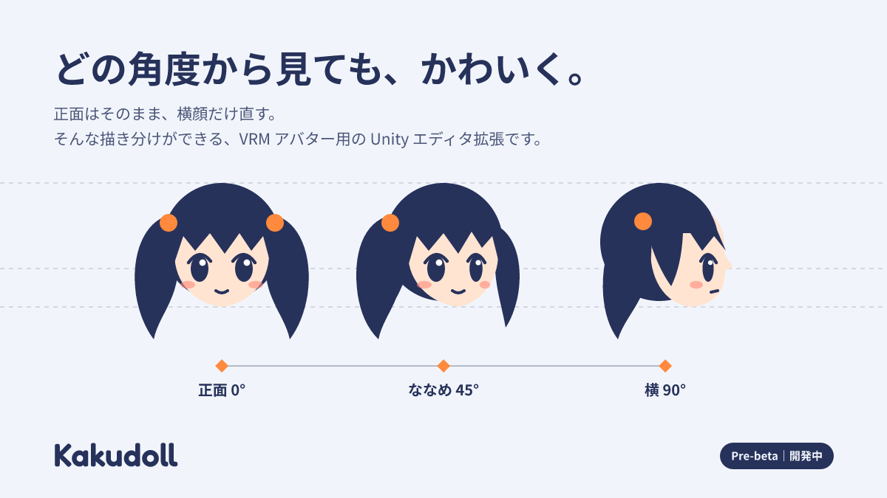

# Kakudoll

<p align="center">
  
</p>

見る角度によってアバターの形を変えられるようにする、Unity のエディタ拡張です。

アニメでは、正面と横顔で前髪の流れや輪郭をわざと描き変えることがあります。
Kakudoll は、この「角度ごとの描き分け」を VRM アバターで作るためのツールです。
元の VRM やメッシュ、マテリアルは書き換えません。

> 開発中（Pre-beta）です。今は Unity エディタの中でしか動かず、VRChat では使えません。

[English](#english)

## できること

- 顔などのメッシュに、左右の向き（Yaw）ごとのキーを作る
- 頂点を選んでドラッグし、その角度での形を作る（ソフト選択あり）
- 3 つのビューで、角度による形の変化を見る
- 既存の BlendShape をキーの形として取り込む
- 元に戻す・やり直しと、Unity が落ちたときの復元

## まだできないこと

- VRChat での表示
- ゲーム実行中の再生（古い v0.1 形式だけは `VlatApplier` で再生できます）
- 複数メッシュの同時編集、法線の再計算、上下の向き（Pitch）による切り替え

13 万頂点ほどの大きなメッシュでは、確定や元に戻すのに 0.2〜0.3 秒かかります。
今後の予定は [ROADMAP](docs/product/ROADMAP.md) にまとめています。

## 必要なもの

- Unity 2022.3.62f3（Built-in Render Pipeline）
- UniVRM v0.128.3（VRM 1.0 に対応。VRM 0.x は読み込みのみ）
- Git

動作を確認しているのは Windows 11 だけです。ほかのバージョンの Unity や、macOS・Linux では試していません。

## 導入

プロジェクトのバックアップを取ってから、`Packages/manifest.json` の `dependencies` に次の 3 行を足します。

```json
"com.vrmc.gltf": "https://github.com/vrm-c/UniVRM.git?path=/Assets/UniGLTF#v0.128.3",
"com.vrmc.vrm": "https://github.com/vrm-c/UniVRM.git?path=/Assets/VRM10#v0.128.3",
"jp.vlat.core": "https://github.com/marc2825/Kakudoll.git?path=/Packages/jp.vlat.core#main"
```

Unity に戻ると読み込みが始まり、メニューに **Kakudoll** が追加されます。
`#main` は開発中の最新版です。リリース後は `#v0.1.0` のようにバージョンを指定できます。

Unity Hub の 3D テンプレート以外で作ったプロジェクトでは、`"com.unity.test-framework": "1.1.33"` も足してください（UniVRM が使います）。

clone したリポジトリを使う場合は、3 行目を `"jp.vlat.core": "file:C:/path/to/Kakudoll/Packages/jp.vlat.core"` にします。
リポジトリの `VLatProject` を Unity Hub で開けば、設定済みのプロジェクトとしてすぐに試せます。

更新するときは、先に [CHANGELOG](Packages/jp.vlat.core/CHANGELOG.md) を読み、作ったファイルのバックアップを取ってください。

削除するときは、`manifest.json` から `jp.vlat.core` の行を消し、プロジェクトの `Library/VLat/` フォルダ（未保存の編集の復元用データ）を消します。
保存したファイルはそのまま残ります。

## 使い方

1. メニューの **Kakudoll > Editor** を開く
2. 「VRM を開く…」でアバターを読み込む（編集するのはプレビュー用の複製です）
3. 直すパーツ（前髪や顔のメッシュ）と、形を変えたい角度を選んで「編集をはじめる」を押す
4. 「選ぶ」（キー 2）で頂点を選び、「動かす」（キー 3）で編集ビューの中をドラッグする
5. 下の角度レールを引いて、角度ごとの見え方を確かめる（← → でとなりのキーへ移れます）
6. 「保存」する

保存すると `.vlat.json` と `.vlat.bin` の 2 つのファイルができます。

## ファイルの扱い

- 保存は上書きで、前の状態には戻せません。大事なファイルはバックアップを取るか、Git で管理してください。
- 保存中に Unity が落ちても、次に開いたときに保存前か保存後のどちらかの状態に戻ります（[保存の仕組み](docs/product/SAVE_AND_RECOVERY.md)）。
- 人からもらった `.vlat.json` が読むのは、同じフォルダ（とその下のフォルダ）にあるファイルだけです。

## 困ったとき

- **UniGLTF で `UnityEditor.TestTools` や `NUnit` が見つからないというエラーが出る**
  `manifest.json` に `"com.unity.test-framework": "1.1.33"` を足してください。
- **UniVRM を取得できない**
  Git がインストールされているか、ネットにつながっているかを確認してください。
- **「許可されたフォルダの外を指しています」と出る**
  `.vlat.bin` や画像を、`.vlat.json` と同じフォルダに置いてください。
- **「前回の保存が途中で中断され…」と出る**
  Kakudoll Editor でそのファイルを開くと、保存前の状態に戻ります。

不具合は [Issue](https://github.com/marc2825/Kakudoll/issues/new/choose) へ、質問は [Discussions](https://github.com/marc2825/Kakudoll/discussions) へどうぞ。
脆弱性は公開の場に書かず、[SECURITY.md](SECURITY.md) の方法で知らせてください。

## 開発に参加する

[CONTRIBUTING.md](CONTRIBUTING.md) を読んでください。Unity がなくても動くテストは、次のコマンドで実行できます。

```bash
python3 -m pip install "jsonschema>=4.10,<5"
python3 scripts/run_license_free_checks.py
```

2026-11-22 時点（コミット `20a9449`）で、Unity のテスト（EditMode 413 件、PlayMode 4 件）は Windows 11 / Unity 2022.3.62f3 の手元環境で通っています。
GitHub Actions では Unity のライセンスを設定していないため、まだ実行していません。
テストの詳しい内容と結果は [docs/TESTING.md](docs/TESTING.md) にあります。

設計の資料:

- ファイル形式: [docs/spec/02_FORMAT_SPEC.md](docs/spec/02_FORMAT_SPEC.md)、[docs/product/KEYFORM_V0_2.md](docs/product/KEYFORM_V0_2.md)
- 全体の構成: [docs/spec/03_ARCHITECTURE.md](docs/spec/03_ARCHITECTURE.md)、[docs/product/DECISIONS.md](docs/product/DECISIONS.md)
- VRChat に向けた実験: [docs/experiments/](docs/experiments/)

## 名前

Kakudoll は「角度（kakudo）」と「doll」を合わせた名前です。
開発の初めは「VLat」という名前で、ファイル形式（`.vlat.json`）やパッケージ名（`jp.vlat.core`）に残っています。互換性のため、このまま使います。

ロゴ、アイコン、紹介画像は [docs/assets/brand/](docs/assets/brand/) にあります。

## ライセンス

開発中は [PolyForm Strict License 1.0.0](LICENSE) で公開しています。
非商用の目的なら使えますが、改変したものや複製を配布することと、商用で使うことはできません。Pull Request を送るための変更はかまいません。
完成したら MIT License などに切り替える予定です。

以前 MIT License で公開していた版は、その版については MIT License のままです。
第三者の素材については [THIRD_PARTY_NOTICES.md](THIRD_PARTY_NOTICES.md) を見てください。

---

## English

Kakudoll is a Unity editor extension that lets a VRM avatar change shape with the viewing angle, the way anime artists
redraw bangs or a jawline between front and side views. It never modifies the original VRM, meshes or materials.

It is in pre-beta and runs only inside the Unity Editor. It does not work in VRChat yet.

**Requirements:** Unity 2022.3.62f3 (Built-in Render Pipeline), UniVRM v0.128.3 and Git. Tested on Windows 11 only.

**Install:** back up your project and add these lines to `dependencies` in `Packages/manifest.json`:

```json
"com.vrmc.gltf": "https://github.com/vrm-c/UniVRM.git?path=/Assets/UniGLTF#v0.128.3",
"com.vrmc.vrm": "https://github.com/vrm-c/UniVRM.git?path=/Assets/VRM10#v0.128.3",
"jp.vlat.core": "https://github.com/marc2825/Kakudoll.git?path=/Packages/jp.vlat.core#main"
```

If the project was not made from Unity Hub's 3D template, also add `"com.unity.test-framework": "1.1.33"`.
To uninstall, remove the `jp.vlat.core` line and delete the project's `Library/VLat/` folder.

**Use:** open **Kakudoll > Editor**, load a VRM 1.0 avatar, pick the mesh to fix and the angles (such as 0°, 45° and 90°),
select vertices with Select (2), drag them with Move (3), check each angle on the angle rail, and save. Saving overwrites the file, so keep backups.

**License:** [PolyForm Strict 1.0.0](LICENSE) while in development. You may use it for noncommercial purposes, but you may
not distribute it or modified versions, or use it commercially. Changes made to send a pull request are fine.
The plan is to switch to MIT or a similar license once it is complete.
